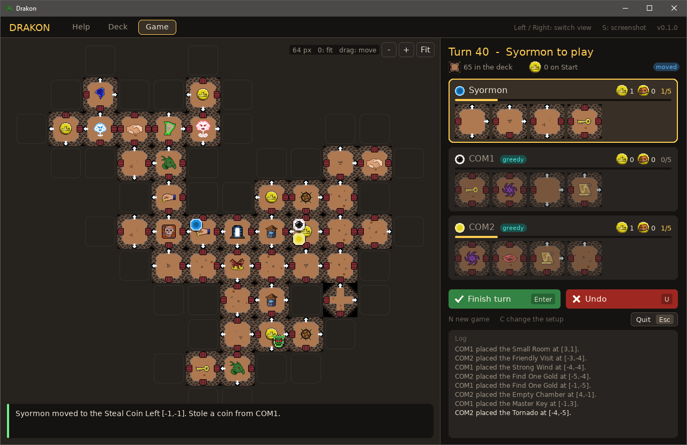
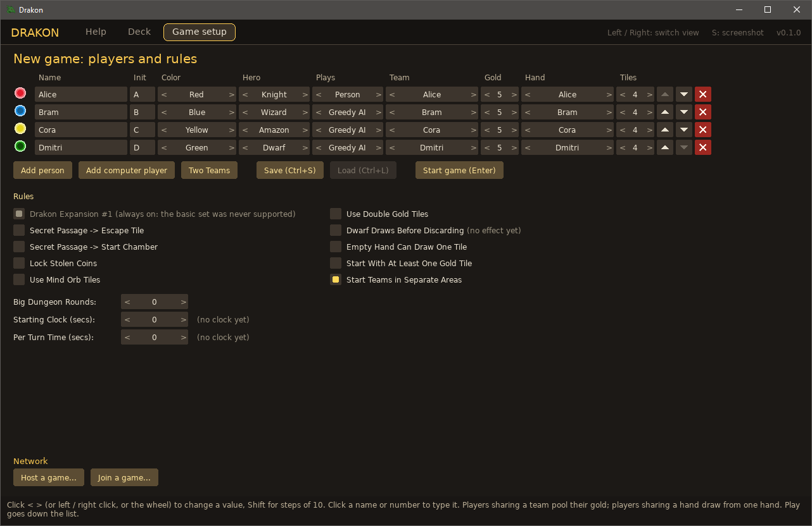
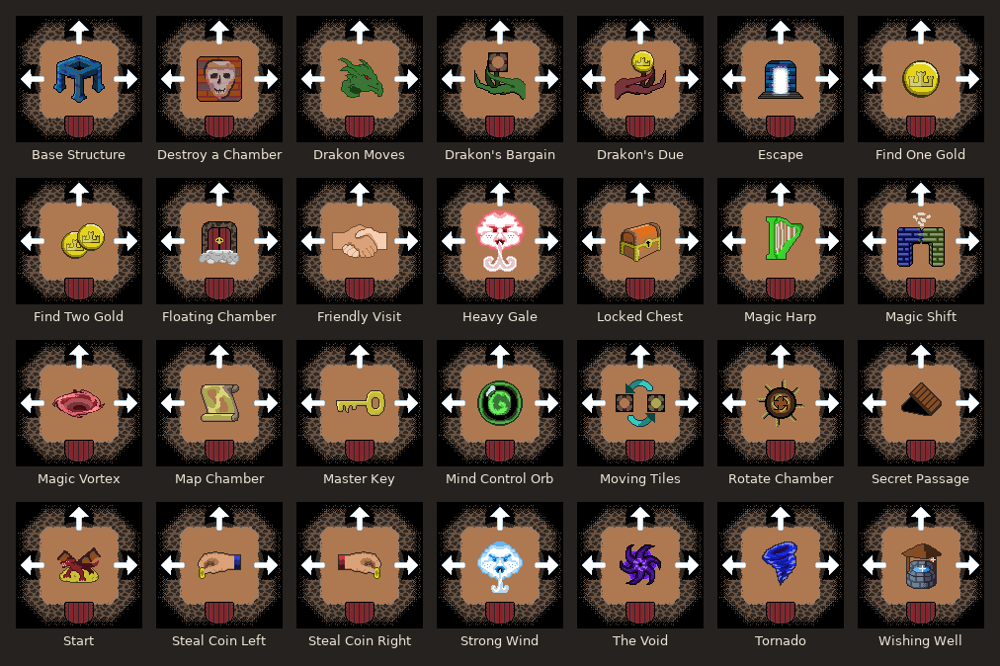

# Drakon (LÖVE)

The LÖVE implementation of the board game Drakon (by Tom Jolly), rebuilt from the original Delphi implementation that I drew assets for in 2018.

## Sample Gameplay

## Developing

I use [Zed](https://zed.dev/) with the [lua-debugger](https://github.com/bigriver-dev/lua-debug-zed) extension to run and debug.

## Code Layout

| Path | What |
|---|---|
| `src/gif.lua` | GIF decoder (pure Lua) |
| `src/assets.lua` | Cached image loading |
| `src/ui.lua` | fonts, colours, boxes, key caps and tags |
| `src/tileart.lua` | Draws a tile from the artwork |
| `src/tiles.lua` | Tile encoding, arrows, rotation, and the original chamber names and rules text |
| `src/deck.lua` | Deck composition and shuffle |
| `src/game.lua` | Game configuration (players, teams, hands, options), game state and setup |
| `src/board.lua` | The dungeon grid |
| `src/ai.lua` | Computer players: "random" & "greedy" implementations |
| `src/setup.lua` | game setup (players, teams, shared hands, options; Two Teams; saving) |
| `src/setupview.lua` | The setup screen |
| `src/gameview.lua` | The game screen; board, heroes, player cards and hands, hints, log (and chat in a network game) |
| `src/session.lua` | Network play (lobby, seats, actions, chat, dropping out and coming back) |
| `src/actions.lua` | A player's action as plain data |
| `src/serial.lua` | Lua values to text and back (shared tables, cycles, known classes) |
| `src/wslink.lua` | The network under `session.lua`: the host's side (listening, with the password) and a joining player's side, over WebSockets |
| `src/wsserver.lua` | A WebSocket server over LuaSocket, run by the hosting player's game (port 5229), non-blocking |
| `src/websocket.lua` | A WebSocket client over LuaSocket (joining from desktop and Android), non-blocking |
| `src/webbridge.lua` | WebSockets in the web build: the browser's own, reached through love.js's `love.js.eval` and `wasm/drakonnet.js` |
| `src/base64.lua` | base64 for network messages |
| `src/joinview.lua` | The join screen |
| ------------------ | --------------- |
| `version.lua` | trigger CI publish release |
| `tools/choicedemo.lua` | Clicks through every chamber choice: `love . --run tools/choicedemo.lua` |
| `tools/setupdemo.lua` | Clicks and types through the setup screen and saves pictures: `love . --run tools/setupdemo.lua` |
| `tools/netdemo.lua` | Network play end to end: `love . --run tools/netdemo.lua` |
| `tools/hostcheck.lua` | Hosts a game for a while, for checking that others (`wasm/joincheck.html`) can join it: `love . --run tools/hostcheck.lua` |
| `tools/animgif.lua` | Records every animated chamber playing at once, with its name, as `anim_tiles.gif` in the save folder (needs ffmpeg): `love . --run tools/animgif.lua`; `DRAKON_SIZE`, `DRAKON_SECONDS`, `DRAKON_FPS` and `DRAKON_COLUMNS` change it |
| `tools/zoomdemo.lua` | checks that clicks still correctly at different zoom levels: `love . --run tools/zoomdemo.lua` |
| `tools/buttondemo.lua` | Clicks the game screen's Finish turn, Undo and Quit buttons: `love . --run tools/buttondemo.lua` |
| `tools/animsheet.lua` | Draws every chamber animation at six moments into one picture: `love . --run tools/animsheet.lua` |
| `tools/lovetests.lua` | Runs every test file inside LÖVE, on `LuaJIT`: `love . --run tools/lovetests.lua` |
| `tools/makeicons.lua` | Makes the app, window and web icons |
| `tools/exeicon.js` | Puts `windows/drakon.ico` into `love.exe`: `node tools/exeicon.js love.exe windows/drakon.ico` |
| `tools/gifref.ps1` | Makes the reference pixel dumps for the GIF test using Windows' decoder |

## Network play

Hosting a game allows connections to both secure and insecure to connect. General Desktop + Mobile versions of the game can only do unecrypted websocket connections. **GitHub Pages** may only open secure WebSockets (`wss://`).  If you want the `GitHub Page` version to connect to a server, you will need to host with a reverse-proxy (nginx, caddy). The Web version of the game cannot host.
